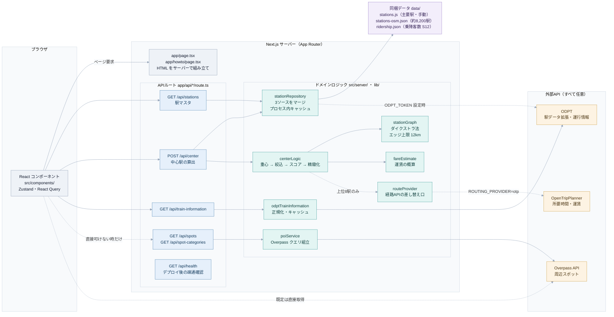
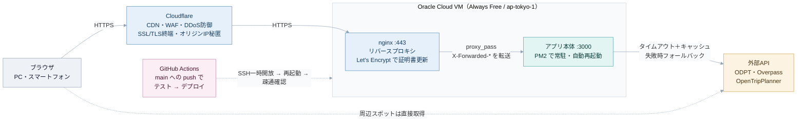

# EkiHub 🗾

複数人の最寄駅を入力すると，**全員が集まりやすい「中心となる駅」**を算出・提案するWebアプリケーションです．日本全国の鉄道駅（約8,200駅）に対応し，地理的重心ではなく**鉄道ネットワーク上の移動時間の公平性**でランキングします．

8つのデザインテーマからページを開くたびに1つを選んで表示し，地図上に各駅からの位置関係と所要時間を可視化します．

## 🌐 今すぐ使う（インストール不要）

公開サーバーにデプロイ済みです．以下の公開URLへブラウザでアクセスするだけで利用できます．

> **▶ [https://ekihub.jp](https://ekihub.jp)**

ローカルで開発・改造したい場合は，後述の「[ローカルで開発する](#-ローカルで開発する開発者向け)」を参照してください．

---

## 主な機能

- **複数駅の入力**：2駅以上を任意の数だけ追加でき，駅名のオートコンプリート付き．
- **中心駅の算出**：鉄道ネットワーク上の移動時間の公平性と近接性を組み合わせた複合スコアで最適駅を提案．
- **駅ネットワークグラフ**：約8,200駅から近接グラフを構築し，ダイクストラ法で実際の鉄道経路に沿った所要時間を算出．
- **規模による絞り込み（トグル切替）**
  - **主要駅限定**：乗降客数20万人/日以上のターミナル駅のみを候補にする．
  - **規模不問**：規模を問わず，純粋に時間の中心駅を候補にする．
- **結果の可視化**：中心駅カード，各最寄駅からの所要時間バー，地図上の経路線・重心表示．
- **候補ランキング**：候補駅をクリックすると，その駅基準でカード・所要時間・地図が切り替わる．

### そのほかの機能

| 機能 | 概要 |
|---|---|
| 手順ガイド | 入力欄の先頭に「最寄駅 → 検索 → 調整」の3手順を示し，今どこまで進んだかを表示． |
| デザインテーマ | Y2K / CHROME・TERMINAL / MONO・MOBILE / FRIENDLY・RETRO / DESKTOP・CLAY / TOY・SOFT / NEUMORPHIC・GLASS / AURORA・VIOLET / SOFT POP の8種．ページを開くたびにランダムで1つを選び，「テーマ」ボタンから切り替えられる（選んだテーマは保存しない）． |
| 多言語対応 | 日本語・英語・中国語・韓国語の切替 |
| メンバー名・人数 | 各駅にメンバー名と人数を設定．人数で重心・平均を重み付け． |
| 重視ポイント | 「こだわり条件」で「近さ ⇄ 公平さ」と**運賃の重視度**を調整． |
| 運賃概算・直通可能性 | 距離から普通運賃を概算し表示．同一路線なら「直通」を表示． |
| 共有URL・QR | 入力・条件をURL化してコピー／Web共有／QRコード表示．開くと自動復元． |
| 結果コピー | 集合駅と各メンバーの所要時間・運賃をテキストでクリップボードにコピー． |
| 周辺スポット | カフェ・居酒屋・カラオケなどのカテゴリを選び，集合駅周辺の検索結果を Google マップで開く． |
| 履歴 | 検索履歴を保存・再実行し，よく使う組合せはお気に入りとして上に固定．ログイン中はアカウントに保存され，別の端末からも使える（端末に残っていた履歴は手動で取り込む）． |
| マイグループ | Googleログイン後，駅・人数・検索条件をグループとして保存し，次回はそのまま検索（後述「[会員ログインとグループ保存](#会員ログインとグループ保存)」）． |
| 共有グループ | マイグループを招待リンクで共有し，メンバーごとの出発駅の登録，集合の予定づくり，候補駅への投票・参加の回答ができる． |
| 印刷 | 結果を印刷用レイアウトで出力． |
| 鉄道運行情報 | 結果欄の下に，首都圏の ODPT 提供路線の運行情報を表示（`ODPT_TOKEN` 設定時）． |

> 移行前の旧版（`legacy/`）にあった「集合時刻・出発逆算（`.ics` 登録）」は，Next.js への移行で引き継いでいないため，現在の画面にはありません．

---

## 技術スタック

| 区分 | 採用技術 | 選定理由 |
|---|---|---|
| 画面・API | Next.js（App Router）+ React + TypeScript | 画面と `/api/*` を1プロセスで配信．算出ロジック（`lib/`）はフレームワーク非依存のまま利用 |
| 状態管理 | Zustand + TanStack Query | 入力・結果の状態と，駅マスタ・算出APIの取得とキャッシュを分担 |
| 地図 | Leaflet（react-leaflet）+ 地理院タイル（淡色地図）+ OpenRailwayMap | APIキー不要・無料．白基調の画面に馴染む淡い背景地図に鉄道路線を重ねる |
| 駅データ | OpenStreetMap（Overpass API）+ 手動拡張 | キー不要で日本全国の駅位置情報を取得 |
| 乗降客数 | 国土数値情報 S12（駅別乗降客数） | 国土交通省の公式オープンデータ．主要駅判定に利用 |
| 経路（任意） | OpenTripPlanner（差し替え式） | `routeProvider` で実所要時間に置換可能．未設定時は距離推定にフォールバック |
| 周辺スポット | Google マップの検索リンク | APIキー不要．利用者がリンクを開いたときだけ Google へ移動する |
| QRコード | qrcode（npm） | 共有URLのQRをクライアント側で生成 |
| 会員ログイン（任意） | Auth.js（Google OAuth）+ SQLite（better-sqlite3） | ログインなしでも検索できる．保存したグループ・履歴だけをサーバーに置く |
| テスト | Vitest + Testing Library | 算出ロジック・API・画面部品を同じ仕組みで検証 |
| ホスティング | Oracle Cloud VM + nginx + PM2 | Always Free枠で無期限無料．Let's EncryptでHTTPS化 |
| CDN / セキュリティ | Cloudflare | WAF・DDoS防御・オリジンIP秘匿・SSL/TLS |
| CI/CD | GitHub Actions | push時に自動テスト＆デプロイ（OCI CLIで動的ファイアウォール制御） |

### サーバー構成（リクエストの流れ）

Next.js（App Router）の1プロセスが，画面の配信と `/api/*` の応答を兼ねます．算出ロジックは `lib/` にフレームワーク非依存のまま置き，APIルートは入力の検証と整形だけを担当します．

<!-- diagram: architecture-server -->


> Mermaid が描画されない環境向けに，同じ図の画像も置いています：[SVG](assets/architecture-server.svg) ／ [PNG](assets/architecture-server.png)

要点は次の3つです．

- **外部APIは無くても動く**：`data/` の同梱データと距離概算へ自動フォールバックするため，トークン未設定でも全機能が成立します．
- **重い処理は1回だけ**：駅マスタのマージと駅グラフの構築は初回リクエストで作ってプロセス内に保持し，以降は使い回します．
- **周辺スポットは Google マップへ渡す**：画面ではカテゴリを選んで Google マップの検索を開くだけで，外部APIは呼びません．図の `/api/spots` と Overpass は旧方式の名残で，現在の画面からは使っていません．

### 画面の構成

```
app/page.tsx・app/results/page.tsx（ページ）
  └── HomeView（src/components/）… 入力・算出・結果表示をまとめる
        ├── StationForm / StepGuide        … 最寄駅・人数・条件の入力と手順ガイド
        ├── ResultCard / TravelList / Ranking / StationMap … 結果カード・所要時間・候補比較・地図
        ├── ResultActions / NearbySpots    … 共有・QR・コピー・印刷，周辺スポット
        └── TrainInformation               … 鉄道運行情報

状態   … src/stores/useEkiHubStore.ts（Zustand：入力・選択中の候補・結果）
取得   … src/hooks/（TanStack Query：駅マスタ・中心駅の算出・履歴）→ src/lib/api.ts → /api/*
文言   … src/i18n/（日本語がマスター．キーを足すと他言語の翻訳漏れが型エラーになる）
テーマ … app/themes/*.css（8種のデザイン）と src/lib/designTheme.ts（ページを開くたびに選ぶ）
```

スマートフォン幅では，入力（`/`）と結果（`/results`）を別ページに分けて表示します．

---

## ディレクトリ構成

```
EkiHub/
├── app/                       # Next.js App Router（ページとAPIルート）
│   ├── page.tsx               # トップページ（入力と結果）
│   ├── results/               # スマートフォン幅の結果ページ
│   ├── howto/                 # 使い方ガイド
│   ├── terms/ privacy/ credits/ # 利用規約・プライバシーポリシー・データ出典
│   ├── account/               # 会員ページ（マイグループ）
│   ├── meet/[token]/          # 共有グループの集合ページ（予定・投票）
│   ├── themes/                # 8種のデザインテーマのCSS
│   └── api/                   # center / stations / train-information / health と会員系のAPI
│                              # （spots / spot-categories は旧方式の名残で，画面からは未使用）
├── src/
│   ├── components/            # React コンポーネント（入力フォーム・結果カード・地図など）
│   ├── hooks/                 # 駅マスタ・算出・履歴・共有URLなどのフック
│   ├── stores/                # 画面の状態（Zustand）
│   ├── lib/                   # 画面側の共通処理（API呼び出し・共有URL・テーマ・駅名検索など）
│   ├── server/                # サーバー側の処理（駅マスタの読込・会員データ・入力検証）
│   ├── i18n/                  # 日本語・英語・中国語・韓国語の文言
│   └── types/                 # 共通の型
├── lib/                       # フレームワーク非依存の算出ロジック
│   ├── centerLogic.js         # 中心駅算出（重心・時間・運賃・人数重み・モードA/B）
│   ├── stationGraph.js        # 駅ネットワークグラフ構築・ダイクストラ法
│   ├── fareEstimate.js        # 距離からの運賃概算
│   ├── odptTrainInformation.js# ODPT運行情報の取得・正規化・キャッシュ
│   ├── routeProvider.js       # 経路API抽象化（Strategy Pattern・差し替え式）
│   ├── stationKana.js         # 駅名の読みの補正
│   └── poiService.js          # 周辺スポット取得（Overpass．現在の画面からは未使用）
├── data/
│   ├── stations.js            # 埋め込み主要駅（乗降客数つき・手動キュレーション）
│   ├── stations-osm.json      # 日本全国約8,200駅（OSM + 手動拡張・コミット対象）
│   ├── ridership.json         # 駅名→乗降客数マップ（S12から生成・コミット対象）
│   ├── station-kana-overrides.json # 駅名の読みの手動補正
│   └── meetingPoints.json     # 待ち合わせスポット（未収集のため空）
├── tests/                     # Vitest のテスト（npm test）
├── scripts/
│   ├── fetchKantoStations.js  # OSMから駅データを取得
│   ├── buildRidership.js      # S12のGeoJSONから乗降客数マップを生成
│   ├── generateKana.js        # kuromojiでkana未登録駅の読みを補完
│   ├── testRouting.js         # 経路精緻化ロジックの単体テスト
│   ├── assembleBundle.mjs     # 本番配布物（standalone）の組み立て
│   ├── setupMemberAuth.mjs / backupMembers.mjs / smokeMemberFlow.mjs # 会員機能の設定・バックアップ・確認
│   ├── renderDiagrams.mjs     # READMEの構成図をSVG/PNGへ書き出す
│   └── smoke*.js              # 旧版向けのブラウザ起動スモークテスト（puppeteer・別途インストール要）
├── public/                    # favicon・OGP画像・テーマのアイコン・robots.txt / sitemap.xml
├── assets/                    # 構成図の画像（renderDiagrams.mjs の生成物）
├── legacy/                    # 移行前（Express + Vanilla JS）の画面．参照用に保存
├── server.js                  # 移行前の Express サーバー．参照用（本番では使わない）
├── Dockerfile / docker-compose.yml # ローカル開発用のコンテナ
├── MEMBER_SETUP.md            # 会員ログインの設定手順
└── .github/workflows/
    └── deploy.yml             # CI/CD（テスト → Actions でビルド → Oracle Cloud VMへ自動デプロイ）
```

---

## 使い方

### ① 公開URLで使う（一般利用者向け）

ブラウザで公開URLを開くだけです．インストール・ログイン不要で，スマートフォンからも利用できます．

> **▶ [https://ekihub.jp](https://ekihub.jp)**

### ② ローカルで開発する（開発者向け）

コードを改造したい場合や，経路API（OTP）を自前で連携したい場合は，手元で起動します．**Node.js 24 以上**が必要です．

```bash
git clone https://github.com/HR0101/EkiHub.git
cd EkiHub
npm install
npm run dev        # ファイル監視つき起動（開発用）
# -> http://localhost:3000
```

> `data/stations-osm.json` と `data/ridership.json` はリポジトリに同梱済みのため，クローン後すぐに動作します．

---

## 中心駅の算出ロジック

`lib/centerLogic.js` の `computeCenterStation` が中核です．

1. **重心算出**：入力駅群の緯度経度を人数で重み付け平均し，地理的重心を求める（地図表示・参考指標用）．
2. **駅グラフ構築**（`lib/stationGraph.js`）：約8,200駅から近接グラフを構築（各駅から最寄りK=6駅を接続，エッジ上限12km）．ダイクストラ法で各入力駅から全駅への所要時間を算出．
3. **候補絞り込み（モード分岐）**
   - 主要駅限定 … 乗降客数20万人/日以上，または主要駅フラグを持つ駅のみ．
   - 規模不問 … 全駅を候補にする．
4. **複合スコア**：`公平性（時間のばらつきの小ささ） × 近接性 × 運賃` を正規化・反転して加重合算．
5. **2段階精緻化**（任意）：上位8駅のみ，経路API（あれば）で実所要時間・運賃・乗換回数を取得して再ランキング．

### エッジ上限12kmの意味（海上重心問題の根治）

`stationGraph.js` の `DEFAULT_EDGE_CAP_M = 12000`（12km）は単なるパフォーマンスパラメータではありません．東京湾横断（久里浜-浜金谷間など）は約30kmあるため，12kmを上限とすることで**海を渡るショートカットがグラフ上に物理的に存在しなくなり**，重心が海上に出ても海を渡る経路は生まれません．

---

## デプロイ

### インフラ構成

<!-- diagram: architecture-infra -->


> 画像版：[SVG](assets/architecture-infra.svg) ／ [PNG](assets/architecture-infra.png)

- **Cloudflare**：CDN・WAF・DDoS防御・オリジンIP秘匿・SSL/TLS終端
- **nginx**：リバースプロキシ（`Host` / `X-Forwarded-Proto` を転送し，OGP の絶対URLを正しく生成）
- **Next.js（standalone 出力）**：アプリ本体（:3000）を **PM2** で常駐・自動再起動
- **Let's Encrypt（certbot）**：TLS証明書を取得し，自動更新

### CI/CD（GitHub Actions）

`main` ブランチへの push で自動的にテスト＆デプロイが走ります（`.github/workflows/deploy.yml`）．

```
push → テスト（vitest / testRouting.js）
     → Actions 上で next build（standalone 出力を生成）
     → OCI CLIでSSHファイアウォールを一時開放
     → 成果物を scp で配送 → 隣に展開して入れ替え → pm2 へ登録し直して起動
     → ヘルスチェック（VM内の :3000 → 外から ekihub.jp）
     → ファイアウォールを自動クローズ
```

**ビルドは VM ではなく Actions 側で行います**．本番VMはメモリ954MiB・スワップ無しで，`next build` が OOM するためです．VM は出来上がった `standalone` を受け取って起動するだけにしてあります．

SSHポートは通常自宅IPのみに制限しており，デプロイ時のみ GitHub Actions ランナーのIPを動的に許可→完了後に自動削除します．認証情報はすべて GitHub Secrets に格納しています．

### 環境変数（任意）

外部APIを使う場合のみ設定します．いずれも未設定で動作します（埋め込みデータ＋距離概算へ自動フォールバック）．

| 変数 | 用途 |
|---|---|
| `PORT` | 待受ポート（既定：3000） |
| `ODPT_TOKEN` | 公共交通オープンデータセンターのアクセストークン．駅データ拡張と鉄道運行情報カードに使用 |
| `ROUTING_PROVIDER` | 経路APIの種別（現在は `otp` に対応） |
| `ROUTING_OTP_URL` | OTP2 の GraphQL エンドポイント |
| `ROUTING_TIMEOUT_MS` | 経路APIのタイムアウト（既定：8000） |

---

## 経路APIで所要時間・運賃を精緻化する（任意・無料）

既定では所要時間・運賃を距離から概算します．より正確にしたい場合は，**無料・キー不要**の [OpenTripPlanner (OTP)](https://www.opentripplanner.org/) を自前で立てて連携できます．

### 仕組み（2段階方式）

約8,200駅すべてを経路APIで叩くことはしません．距離概算で上位8駅に絞ってから実APIで精緻化することで，呼び出しは「8駅 × メンバー数」程度に抑えます．経路APIが未設定・到達不可・タイムアウトの場合は，自動的に距離概算へフォールバックします．

### OTPの起動例

```bash
# 1) Java 17+ と OTP2 の jar を用意
# 2) GTFSとOSM(.pbf)を graphs/japan/ に配置
java -Xmx4G -jar otp-2.x.jar --build --serve graphs/japan
# -> http://localhost:8080 で起動

# 3) EkiHub から接続
ROUTING_PROVIDER=otp \
ROUTING_OTP_URL=http://localhost:8080/otp/routers/default/index/graphql \
npm start
```

> 将来 駅すぱあと等へ差し替える場合は，`lib/routeProvider.js` の `makeProviderFromEnv` に分岐を追加してください（プロバイダは `{ minutes, fareYen, transfers }` を返す共通インターフェースです）．

---

## データ更新

外部データを最新化したい場合の手順です．

### 駅データ（OSM）

```bash
node scripts/fetchKantoStations.js
# -> data/stations-osm.json を再生成
```

### 乗降客数データ（国土数値情報 S12）

1. [国土数値情報「駅別乗降客数」](https://nlftp.mlit.go.jp/ksj/gml/datalist/KsjTmplt-S12.html) からGeoJSONをダウンロードして展開．
2. 展開先のGeoJSONを指定して実行：

```bash
node scripts/buildRidership.js /path/to/S12-23_NumberOfPassengers.geojson
# -> data/ridership.json を再生成
```

### 駅名の読み補完

```bash
node scripts/generateKana.js
# -> kana未登録駅の読みをkuromojiで補完
```

更新後はサーバーを再起動すると反映されます．

> `stations-osm.json`（1.4MB）と `ridership.json` は生成物を含みますが，外部APIの可用性が保証されないこと，手動で追加・修正したデータが多く含まれること，クローン後すぐに動作させることを重視して，あえてGitにコミットしています．

---

## 調整ポイント

- **主要駅の閾値**：`src/server/stationRepository.ts` の `MAJOR_THRESHOLD` と `lib/centerLogic.js` の `MAJOR_RIDERSHIP_THRESHOLD`（どちらも既定20万人/日）を変更すると，主要駅限定モードの候補数を増減できます．2箇所は揃えてください．地方の主要駅は `data/stations.js` の `getMajorThreshold` が地域ごとに低い閾値で判定します．
- **スコアの重み**：`lib/centerLogic.js` の `DEFAULT_WEIGHT_FAIRNESS`（「近さ」と「公平さ」の配分）と，UIの運賃重視スライダーでバランスを調整できます．
- **精緻化する駅数**：`computeCenterStation({ refineCount })`（既定8）で，経路APIで精緻化する上位候補数を変更できます．
- **エッジ上限**：`lib/stationGraph.js` の `DEFAULT_EDGE_CAP_M`（12km）．この値を安易に上げると海上を渡るショートカットが復活するため注意が必要です．

---

## データ出典・ライセンス

- 駅位置情報：© OpenStreetMap contributors（ODbL）
- 乗降客数：国土交通省「国土数値情報（駅別乗降客数データ）」
- 背景地図：地理院タイル（国土地理院の淡色地図）
- 鉄道路線の重ね合わせ：OpenRailwayMap（表示スタイル CC BY-SA 2.0），地図データ © OpenStreetMap contributors

## GitHubの言語集計について

`legacy/` は移行前の実装を参照用に保存したディレクトリです。
現行アプリの構成を言語集計に反映するため、`.gitattributes` でこのディレクトリだけを集計対象外にしています。
現行のJavaScriptは集計対象のままです。この設定は実行時の動作やビルドには影響せず、JavaScriptからTypeScriptへの移行完了を意味するものではありません。

## 会員ログインとグループ保存

Googleログイン後に、駅・人数・絞り込み・公平さ／運賃の重みをグループとして保存できます。画面右上の「マイグループ」から保存・編集・削除し、検索画面の保存済みグループから再検索できます。会員登録なしの検索も利用できます。

Google OAuthの設定、ローカル起動、本番でデータを残す方法は [MEMBER_SETUP.md](MEMBER_SETUP.md) を参照してください。Google側の設定前はログインを準備中と表示します。ローカルの検索履歴は自動ではアカウントへ送信しません。
